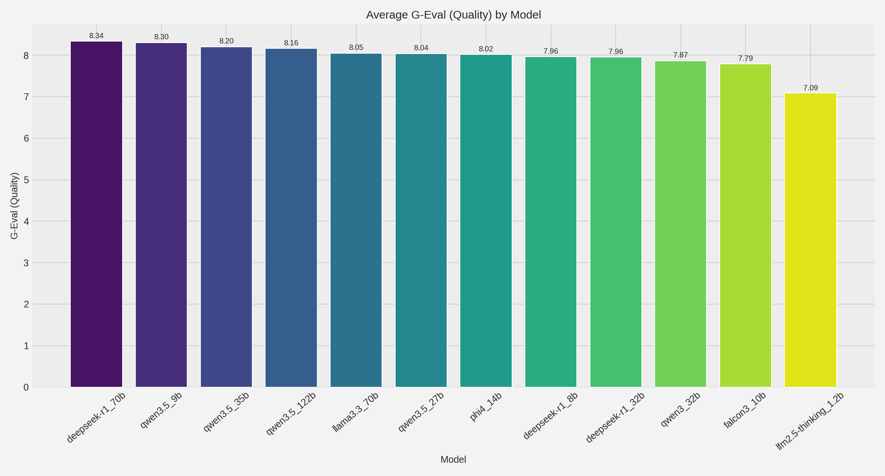
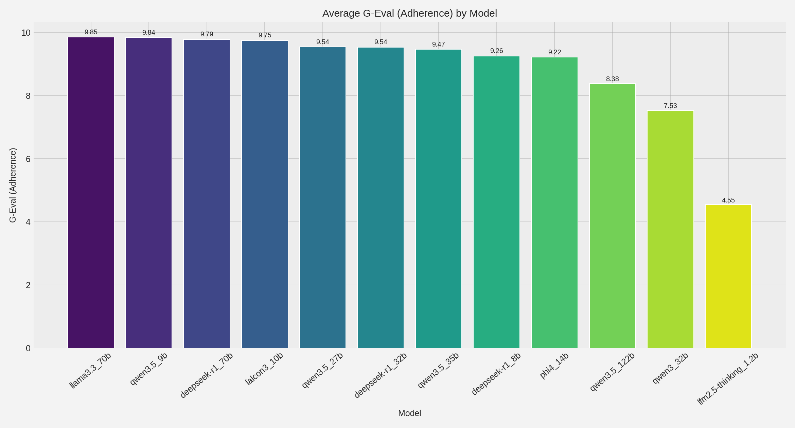
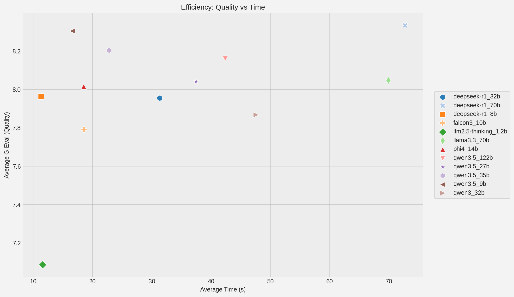

# SCPe Benchmark

A benchmarking pipeline for evaluating large language models on structured Brazilian forensic case data from the SCPe dataset. The project generates forensic reports in Portuguese and compares textual quality, factual adherence, generation time, and token usage across models.

## Overview

The benchmark applies the same LangGraph workflow to each selected model and dataset row:

1. **Planner:** loads the case and creates a fixed report outline.
2. **Writer:** generates the report from the permitted case fields.
3. **Evaluator:** scores textual quality and factual adherence using an LLM judge, with an additional structural omission penalty.
4. **Save:** exports the generated report, evaluation results, execution trace, and performance metrics.

The report outline comprises **HISTÓRICO**, **EXAMES** (DO LOCAL, VESTÍGIOS DO LOCAL, and VESTÍGIOS DO CADÁVER), **ANÁLISE**, and **CONCLUSÃO**.

The CSV benchmark uses a fixed plan; the planner does not call an LLM to derive the outline. Generation and evaluation are separate stages, and the graph proceeds from evaluation to saving without a reviewer feedback loop.

## Dataset Access

The SCPe input dataset is not distributed directly with this repository. For access inquiries, contact:

**Leandro D. Carneiro**  
**Email:** [leandropcdf@gmail.com](mailto:leandropcdf@gmail.com)

Please include a brief description of your intended use.

Once obtained, place the CSV at:

```text
dados/input/SCPe_Dataset.csv
```

The loader expects UTF-8 encoding, a header row, and `#` as the default delimiter. Report generation uses only these columns:

| Column | Content |
| --- | --- |
| `DESC_LOCAL` | Description of the scene |
| `VEST_LOCAL` | Evidence and findings at the scene |
| `VEST_CADAVER` | Evidence and findings concerning the body |

The optional `TEXTO_ORIGINAL` column is used by the analysis script to calculate the generated-to-original word-count ratio. It is not passed to the generator by the CSV loader.

## Repository Structure

| Path | Purpose |
| --- | --- |
| `main.py` | Benchmark entrypoint |
| `config.py` | Dataset paths, provider settings, model list, and evaluation settings |
| `graph/laudo_graph.py` | LangGraph definition and model/case execution loop |
| `graph/nodes/` | Planner, writer, evaluator (`evoluator_node.py`), and save nodes |
| `services_packages/` | LLM clients, Ollama model management, dataset loading, and session utilities |
| `graph/gerar_grafo.py` | Workflow visualization utility |
| `graphics/` | Analysis script, aggregate metrics, and committed charts |
| `dados/input/` | Locally supplied dataset; not included in this repository |
| `dados/output/` | Runtime reports, traces, and metrics; created during execution |

## Requirements

Use Python 3.10 or later, a reachable inference service, and OpenAI API access for the current evaluator. Hardware requirements depend on the generation model and serving configuration.

```bash
git clone https://github.com/ldiascarneiro/SCPe-Benchmark.git
cd SCPe-Benchmark
python3 -m venv .venv
source .venv/bin/activate
python -m pip install -r requirements.txt
mkdir -p dados/input
```

The default generation provider is Ollama. The evaluator uses `ChatOpenAI` independently of the generation provider, with `gpt-4o-mini` as the configured judge. Local generation therefore still requires OpenAI access for a complete benchmark run. The evaluator sends the generated report and case inputs to the configured OpenAI judge; use data authorized for that processing.

## Configuration

Review `config.py` before running:

| Setting | Purpose |
| --- | --- |
| `DATASET_CSV_PATH` | Input CSV path |
| `CSV_DELIMITER` | CSV delimiter; default `#` |
| `DATASET_START_ROW` | First data row to process, indexed from zero |
| `DATASET_NUM_ROWS_TO_PROCESS` | Number of rows; `-1` processes all remaining rows |
| `LLM_PROVIDER` | Generation backend: `ollama`, `local_vllm`, or `openai` |
| `CHAT_MODEL_URL` | Ollama endpoint or OpenAI-compatible vLLM base URL |
| `BENCHMARK_MODELS` | Models to run through the same pipeline |
| `LLM_MODEL_NUM_CTX` | Ollama context window |
| `MAX_TOKENS` / `MAX_TOKENS_RETRY` | Generation and retry output limits |
| `BENCHMARK_CONTINUE_ON_ERROR` | Whether to continue after an individual model/case failure |
| `OPENAI_API_KEY` | OpenAI credential used by evaluation and OpenAI generation |
| `GEVAL_MODEL_NAME` | Evaluation model |
| `SECTION_MIN_CONTENT_WORDS` | Threshold used to detect very short sections |
| `ADHERENCE_EMPTY_SECTION_PENALTY_PER_SECTION` | Penalty for each missing or very short main section |
| `ADHERENCE_OMISSION_MAX_PENALTY` | Maximum structural omission penalty |

For an initial run, set a small case range and choose a model available to your server. For example, edit these values in `config.py`:

```python
LLM_PROVIDER = "ollama"
CHAT_MODEL_URL = "http://localhost:11434"
BENCHMARK_MODELS = ["qwen3.5:9b"]
DATASET_START_ROW = 0
DATASET_NUM_ROWS_TO_PROCESS = 1
```

For OpenAI credentials, replace the existing key assignment in `config.py` with environment-variable loading:

```python
import os
OPENAI_API_KEY = os.environ.get("OPENAI_API_KEY", "")
```

Set that variable in your execution environment. Do not commit credentials. Other settings are Python constants in the current configuration; setting similarly named environment variables does not automatically override them.

When switching providers, update `BENCHMARK_MODELS` to the identifiers accepted by the selected backend. For vLLM, use its OpenAI-compatible API base URL in `CHAT_MODEL_URL`.

## Running the Benchmark

```bash
python main.py
```

The entrypoint generates all main report sections (`limit_top_sections=0`, `preview_only=False`). It processes the configured row range for every model in `BENCHMARK_MODELS`.

With Ollama, the pipeline checks installed models and requests downloads for missing models before starting the experiment loop. The server needs sufficient storage and memory for the selected models.

The evaluator must return valid numeric scores for both quality and adherence before the save node runs. Evaluation failures are reported as failed runs; with `BENCHMARK_CONTINUE_ON_ERROR=True`, the loop proceeds to the next model/case pair.

## Metrics

| Metric | Interpretation |
| --- | --- |
| Textual quality | Judge score from 0 to 10 for clarity, coherence, organization, technical tone, and language quality |
| Dataset adherence | Judge score from 0 to 10 for coverage, factual fidelity, and avoidance of unsupported content, reduced by structural omission penalties |
| Generation time | Recorded generation duration in seconds |
| Total tokens | Recorded generation token usage |
| Length ratio | Generated report word count divided by `TEXTO_ORIGINAL` word count, when available during analysis |
| Estimated theoretical computation | Parameter/token-based estimates, rather than measured GPU throughput |
| Generation diagnostics | Retry, completion saturation, and suspected truncation indicators |

With the committed defaults, each missing or very short main section incurs a 1-point adherence penalty, capped at 4 points. The minimum section length threshold is 80 words, and the adjusted adherence score is floored at zero.

The plotting utility can ingest externally supplied BERTScore values, but the current evaluation node does not compute BERTScore. The committed aggregate CSV leaves that field empty.

## Outputs

Each model/case run creates a session directory under `dados/output/generation_*`. Saved artifacts include:

* `00_dataset_case.json` and `00_input_perito.txt`: case inputs.
* `01_plan.json` and `02_plan_trace.json`: fixed outline and planning trace.
* `execution_log.jsonl`: session events.
* `doc_generated_<timestamp>.txt`: generated report.
* `quality_report.json`: evaluation summary.
* `plan_trace.json`: planning metadata.
* `05_generation_metrics.json`: generation and evaluation metrics.
* `generation_manifest.json`: output and model identifiers.

Successful saved runs also append records to `dados/output/metrics_history.jsonl`. An interrupted or failed run may leave a partial session directory without a saved history record.

## Available Results

The committed [aggregate metrics](graphics/benchmark_aggregated_metrics.csv) contain results for 12 models. Values below are means from that file, rounded for display; the run counts differ between models.

| Model (artifact ID) | Runs | Quality (0–10) | Adherence (0–10) | Time (s) | Total tokens |
| --- | ---: | ---: | ---: | ---: | ---: |
| `deepseek-r1_32b` | 4362 | 7.956 | 9.536 | 31.32 | 4734 |
| `deepseek-r1_70b` | 4362 | 8.335 | 9.785 | 72.69 | 5096 |
| `deepseek-r1_8b` | 4351 | 7.964 | 9.255 | 11.35 | 4801 |
| `falcon3_10b` | 4362 | 7.792 | 9.750 | 18.59 | 5670 |
| `lfm2.5-thinking_1.2b` | 4350 | 7.087 | 4.549 | 11.58 | 9290 |
| `llama3.3_70b` | 4361 | 8.048 | 9.852 | 69.88 | 5007 |
| `phi4_14b` | 4358 | 8.016 | 9.217 | 18.51 | 5178 |
| `qwen3.5_122b` | 4358 | 8.162 | 8.376 | 42.37 | 5035 |
| `qwen3.5_27b` | 4357 | 8.042 | 9.541 | 37.45 | 4621 |
| `qwen3.5_35b` | 4357 | 8.204 | 9.466 | 22.81 | 4890 |
| `qwen3.5_9b` | 4356 | 8.305 | 9.843 | 16.60 | 4717 |
| `qwen3_32b` | 4359 | 7.868 | 7.529 | 47.54 | 5525 |

These are descriptive results from the committed artifact. The CSV alone does not establish paired case coverage, statistical significance, hardware equivalence, or a universal model ranking. The currently enabled model list in `config.py` is a subset of the models represented in these results.

### Textual Quality



### Factual Adherence



### Quality and Generation Time



Additional charts for tokens, length ratio, generation time, and estimated computation are available in [`graphics/`](graphics/).

## Generating Analysis Charts

After producing local run outputs, execute:

```bash
python graphics/generate_benchmark_graphs.py --output-dir graphics/local_run
```

By default, the script reads `dados/output/metrics_history.jsonl`, scans session metric files, and uses the input dataset to calculate missing length ratios. The separate output directory preserves the committed reference charts and aggregate CSV.

Use `--help` to inspect options for custom history, dataset, scan directory, and additional metric inputs:

```bash
python graphics/generate_benchmark_graphs.py --help
```

The script generates `benchmark_aggregated_metrics.csv` and charts named `avg_*` and `efficiency_*` in the selected output directory. Those filenames differ from the committed `scpe_*` reference images displayed above. Reproducing the aggregate results requires the corresponding run records; the repository does not include those raw sessions.

## Reproducibility Notes

Record the dataset version and case range, repository commit, exact model identifiers and quantization, inference server version, hardware, configuration, and judge model for each experiment. Preserve failures and compare common case subsets when making paired model comparisons. Keep each experiment's output directory separate to avoid mixing repeated runs in the appended history.

LLM judge scores are automated assessments and do not replace expert forensic validation. The `approved` field written by the save node is a pipeline manifest flag, not evidence of human approval.

## Related Project

This README follows the documentation structure of [DRFT Benchmark](https://github.com/ldiascarneiro/DRFT_Benchmark), adapted to the SCPe implementation, dataset fields, metrics, and output layout.
